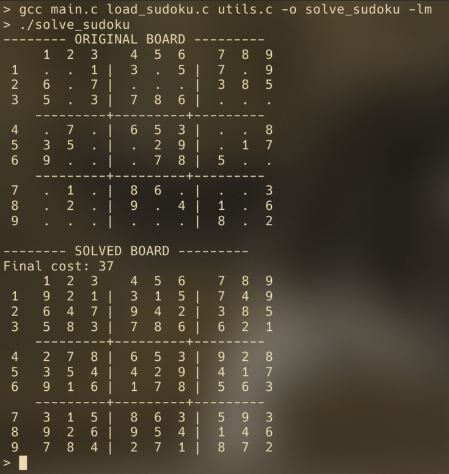

<div align="center">


</div>

# UNI__Simulated-Annealing-for-Solving-Sudoku

A Sudoku solver written in C that uses the Simulated Annealing optimization algorithm to find solutions to Sudoku puzzles.
> Compsci course: Second year, second semester
- Simulated annealing algorithm is in [main.c](https://github.com/werixx1/Simulated-Annealing-for-Solving-Sudoku-In-C/blob/main/src/main.c) 
- Unsolved sudoku board is generated by functions from [previous project](https://github.com/werixx1/terminal-sudoku-in-c) that are in [load_sudoku.c](https://github.com/werixx1/Simulated-Annealing-for-Solving-Sudoku-In-C/blob/main/src/load_sudoku.c)

## Usage

1.  Clone the repository:
    
    ```
    git clone https://github.com/werixx1/UNI__Simulated-Annealing-for-Solving-Sudoku.git
    cd <project-directory>
    cd src
    ```
    
2.  Execute:
    
    ```
    gcc main.c load_sudoku.c utils.c -o solve_sudoku -lm
    ./solve_sudoku
    ```
> (skip -lm if using windows)
       


## Helpful resources:
- [Simulated Annealing – YouTube](https://www.youtube.com/watch?v=FyyVbuLZav8)
- (PL) [Introduction to Simulated Annealing](https://www.researchgate.net/profile/Stanislaw-Kowalik/publication/305489442_SYMULOWANE_WYZARZANIE_W_ZASTOSOWANIU_DO_WYZNACZANIA_EKSTREMUM_GLOBALNEGO_FUNKCJI_O_WIELU_EKSTREMACH_LOKALNYCH_DALEKO_ODDALONYCH_OD_SIEBIE_LUB_BARDZO_ZAGESZCZONYCH/links/579103b108ae0831552f9468/SYMULOWANE-WYZARZANIE-W-ZASTOSOWANIU-DO-WYZNACZANIA-EKSTREMUM-GLOBALNEGO-FUNKCJI-O-WIELU-EKSTREMACH-LOKALNYCH-DALEKO-ODDALONYCH-OD-SIEBIE-LUB-BARDZO-ZAGESZCZONYCH.pdf)
- [What Is Simulated Annealing? – GeeksforGeeks](https://www.geeksforgeeks.org/what-is-simulated-annealing/)
- [Simulated Annealing – Baeldung](https://www.baeldung.com/cs/simulated-annealing)
- [Simulated Annealing for Sudoku Solving – Stack Overflow](https://stackoverflow.com/questions/61553524/simulated-annealing-for-sudoku-solving)
